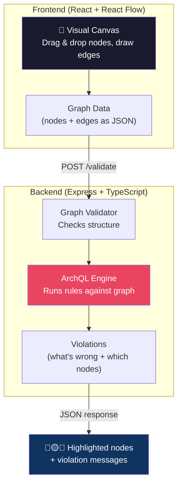

# ArchiteX — Project Explained

## The One-Liner

**ArchiteX is a visual architecture design tool that automatically catches bad design decisions as you draw.**

Think of it like **ESLint, but for system architecture diagrams** instead of code.

---

## The Problem It Solves

When engineers design distributed systems (microservices, databases, load balancers, caches, etc.), they make common mistakes:

- Putting only 1 server behind a load balancer (single point of failure)
- Letting clients talk directly to a database (security nightmare)
- Forgetting to add a cache before a heavily-read database
- Exposing a database to the public internet
- No monitoring, no tracing, no logging

These mistakes are usually caught in **design reviews** by senior engineers — which is slow, inconsistent, and happens too late.

**ArchiteX automates this.** You draw your architecture, and it immediately tells you what's wrong.

---

## How It Works — The Big Picture



### Step by Step:

1. **User draws** an architecture diagram on a canvas (nodes = components, edges = connections)
2. **Frontend sends** the graph as JSON to the backend every time something changes
3. **Backend runs ArchQL rules** against the graph
4. **Backend returns violations** — "Load balancer has only 1 server", "Database is public", etc.
5. **Frontend highlights** the problematic nodes with red/yellow borders and shows messages

---

## What is ArchQL? (The Grammar)

ArchQL is **the language you invented** for writing architecture validation rules. It's a small DSL (Domain-Specific Language) that looks like this:

### Real Example — Catching a Single Point of Failure

```
RULE "Single Server Behind Load Balancer"
SEVERITY ERROR

MATCH (lb:LoadBalancer) -> (srv:Server)

WHERE COUNT(srv) BY lb < 2

YIELD "Load balancer has fewer than 2 servers — single point of failure" WITH lb, srv
```

**In plain English:** "Find every load balancer connected to servers. If any load balancer has fewer than 2 servers behind it, that's an ERROR."

### Another Example — Client Talking Directly to Database

```
RULE "Client Directly Accesses Database"
SEVERITY ERROR

MATCH (c:Client) -> (db:Database)

YIELD "Client is directly connected to a database — bypasses all security layers" WITH c, db
```

**In plain English:** "If any client node has a direct edge to any database node, flag it."

### The Grammar's Role

The grammar (the EBNF in [§18](file:///c:/Users/Charu Goyal/Desktop/ArchiteX/ArchiteX/ArchQL_v3_2.md#L477-L598)) defines the **exact syntax** of these rules — what's valid ArchQL and what isn't. It's the blueprint for building a **parser** that can read `.arch` rule files and turn them into structured data (an AST) that the engine can execute.

---

## How Your Code Fits In

The backend needs to process ArchQL rules through a pipeline:

```
.arch rule files
      │
      ▼
   ┌──────────────────────────────────────────────┐
   │  LEXER  (what you're building now)           │
   │                                              │
   │  Takes raw text like:                        │
   │    MATCH (lb:LoadBalancer) -> (srv:Server)   │
   │                                              │
   │  Produces tokens:                            │
   │    [MATCH] [(] [lb] [:] [LoadBalancer] [)]   │
   │    [->] [(] [srv] [:] [Server] [)]           │
   └──────────────────────────────────────────────┘
      │
      ▼
   ┌──────────────────────────────────────────────┐
   │  PARSER  (next step)                         │
   │                                              │
   │  Takes tokens and builds a tree (AST):       │
   │    RuleNode                                  │
   │      ├── name: "Single Server Behind LB"     │
   │      ├── severity: ERROR                     │
   │      ├── match: (lb:LB) -> (srv:Server)      │
   │      ├── where: COUNT(srv) BY lb < 2         │
   │      └── yield: "LB has < 2 servers..."      │
   └──────────────────────────────────────────────┘
      │
      ▼
   ┌──────────────────────────────────────────────┐
   │  ENGINE  (runs rules against user's graph)   │
   │                                              │
   │  User drew: lb1 → srv1, lb1 → srv2, lb2→srv3│
   │                                              │
   │  Engine finds:                               │
   │    lb1 has 2 servers ✅                       │
   │    lb2 has 1 server  🔴 VIOLATION!           │
   │                                              │
   │  Returns: violation for lb2 + srv3           │
   └──────────────────────────────────────────────┘
```

### What each of your files does:

| File | Purpose |
|------|---------|
| [token.ts](file:///c:/Users/Charu Goyal/Desktop/ArchiteX/ArchiteX/ArchiteX-Backend/src/core/lexer/token.ts) | Defines all the *categories* of tokens the lexer can produce (keywords, operators, literals) |
| [keywords.ts](file:///c:/Users/Charu Goyal/Desktop/ArchiteX/ArchiteX/ArchiteX-Backend/src/core/lexer/keywords.ts) | Maps word strings like `"MATCH"`, `"WHERE"`, `"COUNT"` to their token type |
| [operators.ts](file:///c:/Users/Charu Goyal/Desktop/ArchiteX/ArchiteX/ArchiteX-Backend/src/core/lexer/operators.ts) | Maps symbol strings like `"->"`, `"!="`, `"("` to their token type |
| [diagnostics.ts](file:///c:/Users/Charu Goyal/Desktop/ArchiteX/ArchiteX/ArchiteX-Backend/src/core/lexer/diagnostics.ts) | Error types for when the lexer encounters invalid input |

### Concrete example of what the lexer does:

**Input text (from a `.arch` file):**
```
MATCH (lb:LoadBalancer) -> (srv:Server)
WHERE COUNT(srv) BY lb < 2
```

**Output tokens:**
```
Token(MATCH,    "MATCH",          line=1, col=1)
Token(LPAREN,   "(",              line=1, col=7)
Token(IDENT,    "lb",             line=1, col=8)
Token(COLON,    ":",              line=1, col=10)
Token(IDENT,    "LoadBalancer",   line=1, col=11)
Token(RPAREN,   ")",              line=1, col=23)
Token(ARROW,    "->",             line=1, col=25)
Token(LPAREN,   "(",              line=1, col=28)
Token(IDENT,    "srv",            line=1, col=29)
Token(COLON,    ":",              line=1, col=32)
Token(IDENT,    "Server",         line=1, col=33)
Token(RPAREN,   ")",              line=1, col=39)
Token(WHERE,    "WHERE",          line=2, col=1)
Token(COUNT,    "COUNT",          line=2, col=7)
Token(LPAREN,   "(",              line=2, col=12)
Token(IDENT,    "srv",            line=2, col=13)
Token(RPAREN,   ")",              line=2, col=16)
Token(BY,       "BY",             line=2, col=18)
Token(IDENT,    "lb",             line=2, col=21)
Token(LESS,     "<",              line=2, col=24)
Token(NUMBER,   "2",              line=2, col=26)
Token(EOF)
```

> [!IMPORTANT]
> Notice: `NOT`, `AND`, `OR`, `BY`, `COUNT`, etc. are all **words** that the lexer reads as identifiers and then recognizes as keywords. They are NOT symbolic operators like `!`, `&&`, `||`. That's why they belong in `keywords.ts`, not `operators.ts`.

---

## What the End Product Looks Like

Imagine a web app that looks something like this:

```
┌─────────────────────────────────────────────────────────────────┐
│  ArchiteX — Smart System Canvas                                │
├────────────┬────────────────────────────────┬───────────────────┤
│            │                                │                   │
│  PALETTE   │         CANVAS                 │   VIOLATIONS      │
│            │                                │                   │
│  ☐ Server  │   [Client] ──→ [Load Balancer] │  🔴 ERROR         │
│  ☐ Database│         │           │          │  LB has < 2       │
│  ☐ Cache   │         │      ┌────┴────┐     │  servers — SPOF   │
│  ☐ Queue   │         │   [Server]  ❌       │  Nodes: lb1, srv1 │
│  ☐ LB      │         │      │              │                   │
│  ☐ CDN     │         │   [Database]         │  🟡 WARNING       │
│  ...       │         │                      │  No cache before  │
│            │         │                      │  database          │
│            │                                │  Nodes: srv1, db1 │
├────────────┴────────────────────────────────┴───────────────────┤
│  Simulation: traffic [===== 15000 ====]  latency [=== 200 ===] │
└─────────────────────────────────────────────────────────────────┘
```

- **Left sidebar**: Drag components onto the canvas
- **Center canvas**: Draw your architecture visually (powered by React Flow)
- **Right panel**: Live violations — updates every time you change the diagram
- **Bottom bar**: Simulation sliders to test "what if traffic is 15,000 req/s?"
- **Red borders** on problematic nodes directly on the canvas

---

## TL;DR

| Question | Answer |
|----------|--------|
| **What is ArchiteX?** | A visual tool for designing and validating system architectures |
| **What is ArchQL?** | A custom language for writing validation rules (like "every LB needs 2+ servers") |
| **What does the grammar define?** | The exact syntax of ArchQL — what makes a valid rule file |
| **What does the lexer do?** | Breaks `.arch` rule text into tokens (the smallest meaningful pieces) |
| **What does the parser do?** | Turns tokens into a structured tree (AST) |
| **What does the engine do?** | Runs the AST rules against the user's graph and finds violations |
| **What does the frontend do?** | Visual canvas for drawing + displays violations in real-time |
